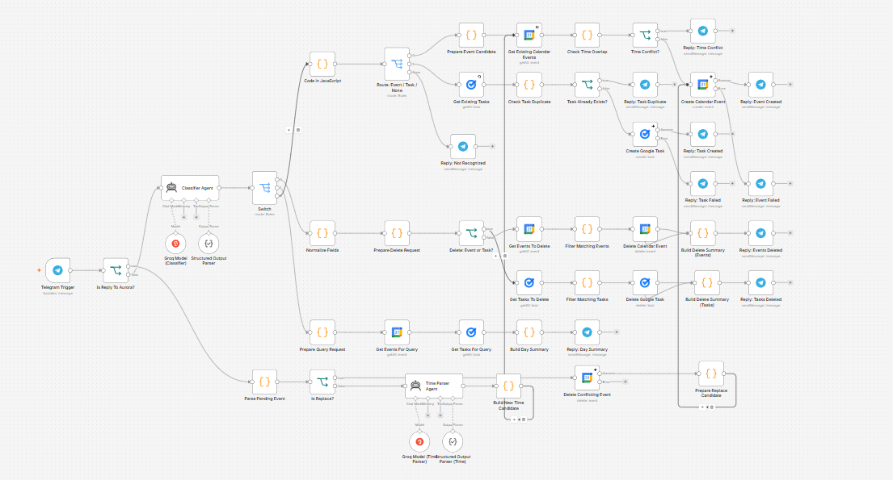
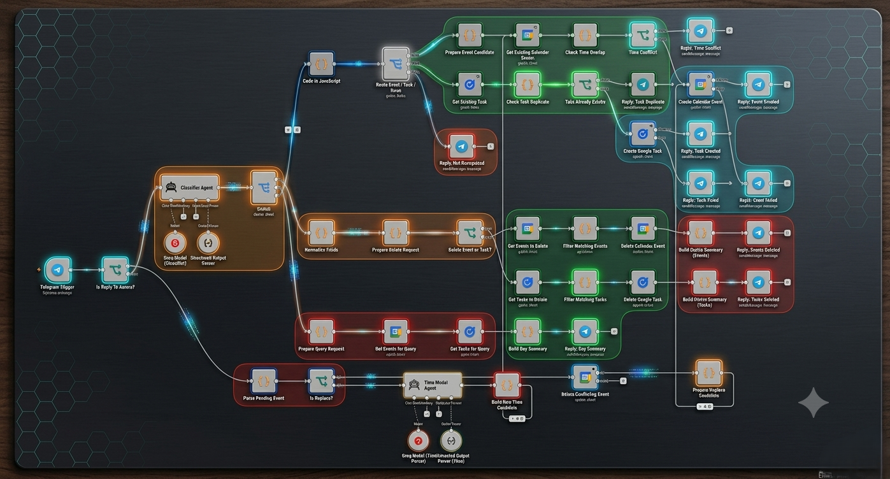

# Aurora — Bengali/English Telegram Assistant for Google Calendar & Tasks

**An n8n workflow that turns a Telegram chat into a natural-language interface for Google Calendar and Google Tasks — understands Bengali, Banglish, and English.**

Send Aurora a message like *"kal bikal 4 tay client call, 30 min"* and it creates a calendar event, checks for time conflicts, and replies in Telegram — no forms, no menus.

---

## What it does

Aurora is a Telegram bot (n8n workflow) that classifies free-text messages and turns them into one of four actions:

1. **Create** an event (Google Calendar) or task (Google Tasks)
2. **Delete** an existing event/task matched by date, time, or keyword
3. **Query** — get a summary of a day's events and tasks
4. **Resolve conflicts** — if a requested time overlaps an existing event, Aurora replies asking for a new time, parses the reply, and re-checks for conflicts before creating the event

It understands Bengali, Banglish (Bengali written in Latin script), and English in the same message, and replies in Bengali.

## How it works

| Stage | What happens |
|---|---|
| **Trigger** | Telegram Trigger node listens for incoming messages |
| **Reply detection** | Checks whether the message is a reply to a previous Aurora message (used for conflict-resolution follow-ups) |
| **Classification** | A Groq-hosted LLM agent (`Classifier Agent`) reads the raw message and extracts a structured `type` (event / task / none) and `entity` (create / delete / details) using a defined system prompt and a structured output parser |
| **Routing** | A `Switch` node routes the classified item to the create, delete, or query branch |
| **Create branch** | Checks for existing events at that time (conflict detection) or duplicate tasks before creating; replies with success/failure and event/task details |
| **Conflict handling** | If the requested time overlaps an existing calendar event, Aurora replies in-thread asking for a new time. The user's reply is parsed by a second Groq agent (`Time Parser Agent`) that resolves relative dates ("kal", "next Monday") and Bengali time-of-day words (সকাল, দুপুর, বিকাল, সন্ধ্যা, রাত) into 24-hour time, then re-checks for conflicts |
| **Delete branch** | Matches existing events/tasks by date, time, and/or keyword, deletes matches, and sends a summary of what was removed |
| **Query branch** | Pulls the day's events and tasks and replies with a formatted daily summary |

All state between the "ask for a new time" reply and the original request is carried via a base64-encoded reference embedded in the Telegram reply-to message — no external database needed.

## Workflow diagram





## Stack

- **[n8n](https://n8n.io)** — workflow orchestration (50 nodes)
- **[Groq](https://groq.com)** (Llama models) — two LLM agents: message classifier and time parser, both using n8n's LangChain agent nodes with structured output parsing
- **Telegram Bot API** — chat interface
- **Google Calendar API** — event creation, conflict checking, deletion, querying
- **Google Tasks API** — task creation, duplicate checking, deletion, querying
- **n8n Code nodes** (JavaScript, Luxon for timezone-aware date handling in `Asia/Dhaka`)

## Repository contents

```
workflow/
  Event_Task_Automation.json   — the exportable n8n workflow (import directly into n8n)
docs/
  screenshots/                 — workflow canvas screenshots
```

## Setup

1. Import [`workflow/Event_Task_Automation.json`](workflow/Event_Task_Automation.json) into your n8n instance (Workflows → Import from File).
2. Configure four credentials in n8n and reassign them on the imported nodes:
   - **Telegram API** — bot token from [@BotFather](https://t.me/BotFather)
   - **Groq API** — API key from [console.groq.com](https://console.groq.com)
   - **Google Calendar OAuth2** — Google Cloud OAuth client with Calendar API enabled
   - **Google Tasks OAuth2** — same Google Cloud project, Tasks API enabled
3. Activate the workflow. Message your bot to test.

> The exported JSON references credentials by name only — no API keys, tokens, or secrets are included. You'll need your own accounts for Telegram, Groq, and Google.

## License

MIT — see [LICENSE](LICENSE). This is a personal/portfolio automation project; reuse and adapt freely.
